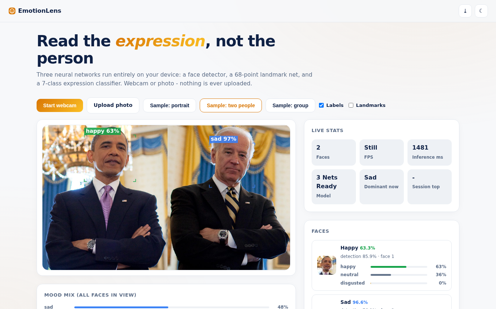
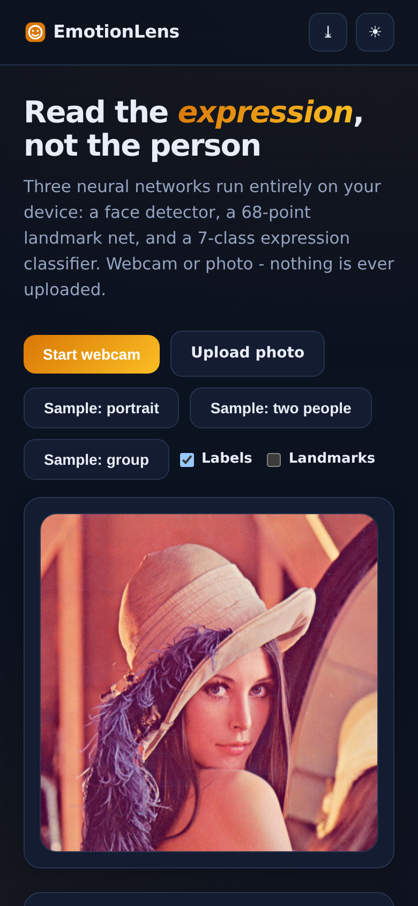

# EmotionLens - Facial Expression Recognition

**Three neural networks running entirely in your browser**: a Tiny-YOLO face detector, a 68-point landmark net, and a 7-class expression classifier (neutral, happy, sad, angry, fearful, disgusted, surprised). Webcam or photos - nothing is ever uploaded.

**Live demo:** https://akash991833.github.io/emotion-recognition/

## Features

- **Real in-browser inference** - face-api.js (tiny_face_detector + face_landmark_68 + face_expression), vendored weights, runs on your device
- **Per-face expression breakdown** - dominant expression with confidence plus top-3 distribution bars for every detected face
- **Mood mix** - aggregate expression distribution across all faces currently in view
- **Expression timeline** - live sessions log each change of dominant expression with timestamp and confidence, plus session summary chips (most frequent states)
- **Live stats** - faces, FPS, inference ms, dominant-now, session top
- **Webcam + uploads + samples** - instant sample photos included
- **PWA** - installable; models cache for offline use after first load
- **Premium UI** - white professional design, navy ink, amber accent, dark + light themes, responsive desktop and mobile

## Screenshots

## Honest limits

The expression net is a compact model trained on posed, lab-style faces (FER-2013 class of datasets). It handles strong, frontal, well-lit expressions well and subtle or mixed ones poorly - "neutral" and "sad" are often close, and glasses, beards, masks or side angles degrade it. Readings are the model's guesses, never a person's real feelings. Stated in-app. All inference is local; webcam needs browser permission (HTTPS/localhost).

## Tech

Vanilla HTML/CSS/JS + face-api.js 0.22.2 (vendored, ~1.1MB of weights). Sample photos: OpenCV samples, ageitgey/face_recognition examples.

## Run locally

Serve the folder (`python3 -m http.server`) and open `http://localhost:8000` (camera needs localhost or HTTPS).
